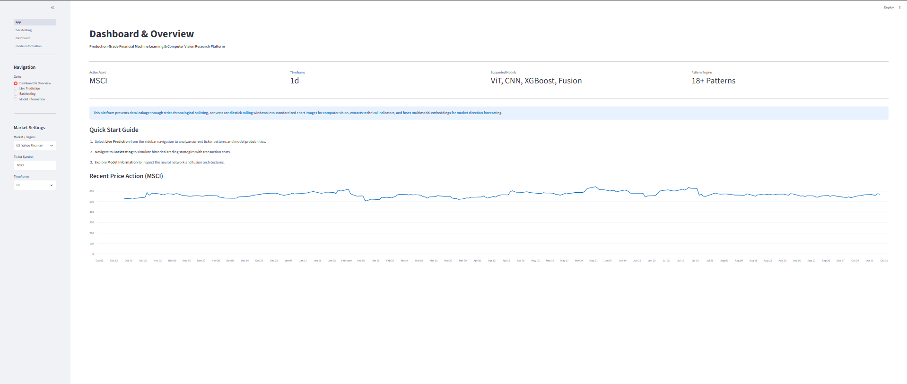
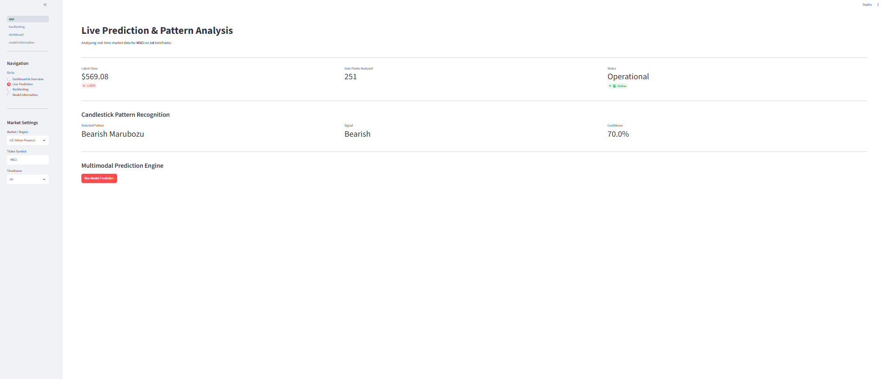
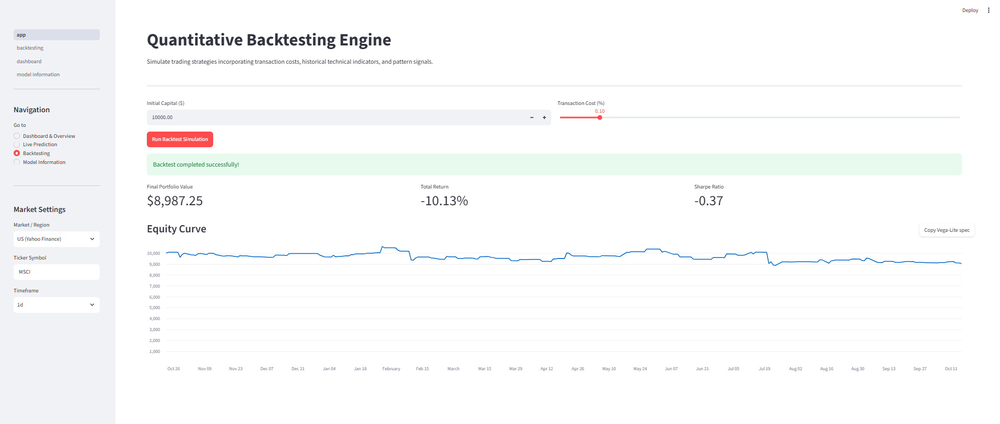
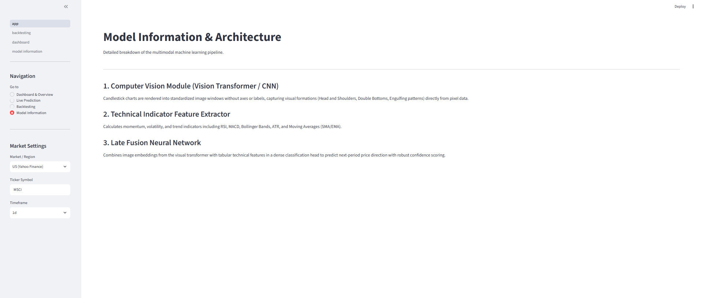

#  Candlestick Predictor & Financial Machine Learning Platform

[](https://www.python.org/)
[](https://streamlit.io/)
[](https://opensource.org/licenses/MIT)

A production-grade, modular financial machine learning and computer vision research platform built in Python and Streamlit. 

---

##  Table of Contents
1. [Executive Summary (For Beginners)](#-executive-summary-for-beginner-and-non-technical-readers)
2. [Platform Preview & Screenshots](#-platform-preview--screenshots)
3. [System Architecture & How It Works (For Developers)](#-system-architecture--how-it-works-for-developers)
4. [Project Directory Structure](#-project-directory-structure)
5. [Installation & Setup Guide](#-installation--setup-guide)
6. [Running the Application](#-running-the-application)
7. [Running Unit Tests](#-running-unit-tests)
8. [License](#-license)

---

##  Executive Summary (For Beginner and Non-Technical Readers)

If you are new to finance or coding, here is what this platform does in simple terms:

* **What is it?** Imagine a smart assistant that looks at stock price charts the same way human financial experts do, but uses artificial intelligence to make faster, data-driven decisions.
* **How does it read stocks?** It downloads real-time stock market data (like Apple, Tesla, or Bitcoin) from Yahoo Finance. It then looks at **Candlestick Charts** (charts that show how high and low a stock's price went during a day).
* **What does the AI do?** 
  1. **Pattern Recognition:** It spots over 18 classic human-trading patterns (like a "Hammer" or a "Doji" which signal if a stock might go up or down).
  2. **Technical Indicators:** It calculates mathematical measurements like RSI (Relative Strength Index) to tell if a stock is "overbought" or "oversold."
  3. **Multimodal Fusion:** It combines visual chart images (computer vision) with numerical indicators (machine learning) to predict where the price is heading next.
* **What is Backtesting?** Before risking real money, the platform includes a simulator. You can test out trading strategies over past historical data to see if you would have made a profit or suffered a loss, complete with simulated transaction fees and risk metrics (like the Sharpe Ratio).

---

## Platform Preview & Screenshots

### 1. Dashboard & Overview
The landing hub provides real-time market settings, asset overview metrics, and architectural summaries of the platform.


### 2. Live Prediction & Pattern Recognition
Real-time pattern detection engine identifying classical formations alongside multimodal model confidence scores and directional probabilities.


### 3. Quantitative Backtesting Engine
Simulates historical trading strategies incorporating transaction costs and technical indicators, displaying final portfolio values, returns, and equity curve charts.


### 4. Model Architecture & Information
Detailed breakdown of the multi-stage machine learning pipeline combining visual chart embeddings and tabular indicator features.


---

##  System Architecture & How It Works (For Developers)

The platform is designed with a strict **separation of concerns**, ensuring modularity, testability, and scalability.

### 1. Data Ingestion & Normalization (`yfinance`)
* Fetches historical and real-time OHLCV (Open, High, Low, Close, Volume) data across configurable timeframes (`1d`, `1h`, `15m`).
* Automatically handles multi-index column flattening and data validation to prevent downstream `NaN` propagation.

### 2. Technical Indicator Feature Extractor (`src/features/technical_indicators.py`)
* Computes momentum, volatility, and trend indicators required for quantitative modeling:
  * **RSI (Relative Strength Index):** 14-period momentum oscillator.
  * **MACD:** Moving Average Convergence Divergence line and signal line.
  * **Bollinger Bands:** Upper and lower volatility bands.
  * **ATR (Average True Range):** Measures market volatility.
  * **Moving Averages:** Simple (SMA) and Exponential (EMA) moving averages.

### 3. Candlestick Pattern Engine (`src/patterns/candlestick_patterns.py`)
* Implements mathematical and heuristic rules to detect 18+ classical candlestick patterns (e.g., Bullish Engulfing, Morning Star, Shooting Star, Doji).
* Outputs detected pattern labels, signal types (`Buy`, `Sell`, `Hold`), and heuristic confidence scores.

### 4. Multimodal Prediction Engine (`src/prediction/predictor.py`)
* **Vision Pipeline:** Renders rolling candlestick chart windows into clean, axis-free images to be processed by a Vision Transformer (ViT) or Convolutional Neural Network (CNN).
* **Tabular Pipeline:** Processes technical indicator matrices via gradient-boosted decision trees (XGBoost).
* **Late Fusion Head:** Combines visual embeddings and tabular logits in a dense classification layer to predict next-period market direction.

### 5. Quantitative Backtesting Engine (`src/backtesting/backtester.py`)
* Simulates trade execution based on generated signal arrays.
* Accounts for realistic friction via customizable **transaction costs** applied on signal flips.
* Calculates financial performance metrics including **Total Return (%)**, **Final Portfolio Value**, and annualized **Sharpe Ratio** (assuming 252 trading days).

---

##  Project Directory Structure

```text
candlestick-predictor/
│
├── app/
│   └── app.py                      # Multi-page interactive Streamlit dashboard UI
├── src/
│   ├── __init__.py                 # Package initializer for module discovery
│   ├── backtesting/
│   │   ├── __init__.py
│   │   └── backtester.py           # Quantitative backtest simulation engine
│   ├── features/
│   │   ├── __init__.py
│   │   └── technical_indicators.py # RSI, MACD, Bollinger Bands, ATR calculator
│   ├── patterns/
│   │   ├── __init__.py
│   │   └── candlestick_patterns.py # Heuristic pattern recognition algorithms
│   ├── prediction/
│   │   ├── __init__.py
│   │   └── predictor.py            # Multimodal fusion inference engine
│   └── visualisation/
│       ├── __init__.py
│       └── chart_generator.py      # Chart rendering utilities for computer vision
├── assets/                         # UI screenshots and documentation images
│   ├── dashboard.png
│   ├── live_prediction.png
│   ├── backtesting.png
│   └── model_info.png
├── tests/                          # Pytest unit testing suite
│   └── test_modules.py
├── requirements.txt                # Production Python dependencies
└── README.md                       # Project documentation
